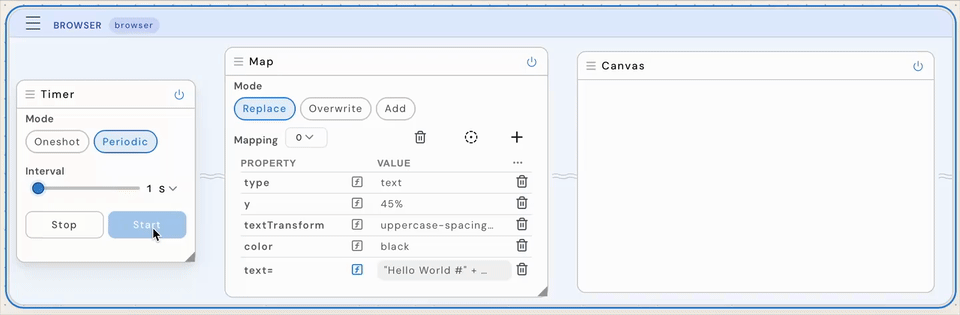

# Readymade

Readymade is a composable, distributed framework for building **interactive apps**. You put them together from small, observable building blocks called **services**.

Your app lives on a **board**, and a board is a single JSON document. It chains **runtimes**, each runtime hosts **services**, and a **facade** on top turns it all into an app you can simply use. You can watch the data move through every step and change any service while the app is running. Build a board by hand, or let **Board Assist** help you (using local or hosted AI models).

Every device brings its own strengths, and your board combines them. Boards run in the browser and in the desktop and mobile apps (macOS, Windows, Linux, iOS, Android), which come with the C++ runtime built in. When you need more, connect runtime servers you host yourself: **hkp-node** e.g. for messaging and server I/O, **hkp-python** e.g. for AI/ML, and **hkp-rt** (C++) e.g. for audio and high-performance work. Once your board is ready, share it with your team and friends.



## Quick start (Web playground)

The fastest way to run Readymade locally requires only **Node.js + npm**:

```bash
cd hkp-frontend
npm install
npm run dev
```

Then open **http://localhost:5555**.

## Build guides by platform

Each target has a self-contained build guide with its prerequisites and output paths:

- **[Web](./README-web.md)** — browser playground and board engine (`hkp-frontend/`, Node + npm only)
- **[macOS](./README-macos.md)** — desktop app with embedded C++ runtime (`./build.sh`)
- **[Linux](./README-linux.md)** — desktop app (`./build-linux.sh`, GTK 4 / WebKitGTK)
- **[Windows](./README-windows.md)** — desktop app (`.\build-windows.ps1`)
- **[iOS](./README-ios.md)** — iPhone/iPad app for device and simulator (`./build-ios.sh`)
- **[Android](./README-android.md)** — Android app (`./build-android.sh`)

### Frontend dev server

When iterating on the UI for the desktop or iOS simulator shells, start the shell frontend with hot reload on port `8555`:

```bash
cd meander/frontend
npm install
npm start
```

Pass `OFF` as the embedded-frontend option in your platform build script (or `-DMEANDER_USE_EMBEDDED_FRONTEND=OFF` to CMake) to load from the dev server instead of bundled assets.

## Runtimes & architecture

| Directory | Role | Documentation |
| --- | --- | --- |
| `hkp-frontend/` | Browser runtime, playground UI, and facade renderer | [README-web.md](./README-web.md) |
| `hkp-rt/` | C++ runtime (audio DSP, local inference, embedded in native apps or standalone) | [hkp-rt/README-docker.md](./hkp-rt/README-docker.md) |
| `hkp-node/` | Node.js runtime server and cloud-board coordinator (SQL, messaging, HTTP, webhooks) | [hkp-node/README.md](./hkp-node/README.md) |
| `hkp-python/` | Python runtime server (local Whisper ASR, Kokoro TTS, GGUF / llama.cpp LLMs) | [hkp-python/README.md](./hkp-python/README.md) |
| `readymade-mcp/` | Read-only MCP knowledge server over docs, example boards, and service contracts | [readymade-mcp/README.md](./readymade-mcp/README.md) |
| `boards/` | Demo boards and worked examples | [docs/content/boards/](./docs/content/boards/) |
| `docs/content/` | Concept guides, service reference, and repository layout | [docs/content/repository.md](./docs/content/repository.md) |

## Tests & Git hooks

Install the repository pre-commit hooks once per checkout:

```bash
./scripts/install-hooks.sh
```

Run all unit and runtime test suites from the repository root:

```bash
./run-all-tests.sh              # unit and runtime suites (frontend, C++, Node, Python)
./run-all-tests.sh --with-e2e   # also runs Playwright browser and cloud E2E suites (Node 22+)
```

For single-component test commands and E2E profiles, see [e2e/README.md](./e2e/README.md) and [docs/content/testing.md](./docs/content/testing.md).

## History

Readymade started in November 2018 under the name Hookup and was developed in private repositories until March 2026. Commits before 27 March 2026 were imported with their original dates from a filtered history and are not expected to build.

## License & project documents

- **License:** GNU AGPL v3.0 — see [LICENSE](./LICENSE) and [COPYRIGHT](./COPYRIGHT)
- **[Contributing](./CONTRIBUTING.md)** — how to contribute and the CLA
- **[Code of Conduct](./CODE_OF_CONDUCT.md)** — how we treat each other and what we hope Readymade gets used for
- **[Security Policy](./SECURITY.md)** — reporting vulnerabilities, safe harbour, and self-hosting notes
- **[Trademark](./TRADEMARK.md)** — using the Readymade name and logo
